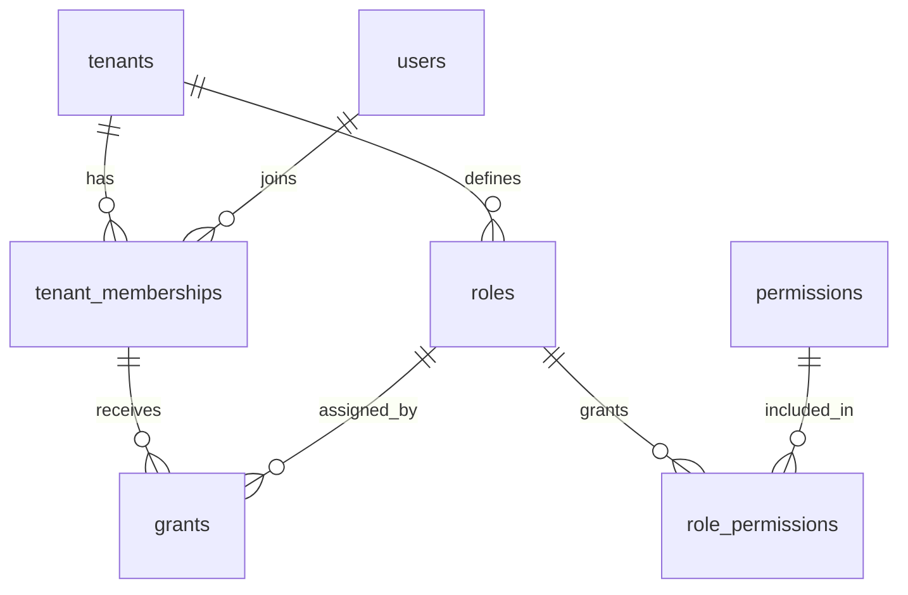

# Tenancy schema (TASK 02)

Tables: tenants, users, tenant_memberships, roles, permissions, role_permissions, grants.
Tenant isolation (BR01): `grants` uses composite foreign keys `(membership_id, tenant_id)` and `(role_id, tenant_id)`, so a grant cannot join a membership and a role from different tenants.
Deletes are RESTRICT everywhere; closing a tenant uses `status = closed`.
`platform_owner` is not a tenant role (platform tables come later).

